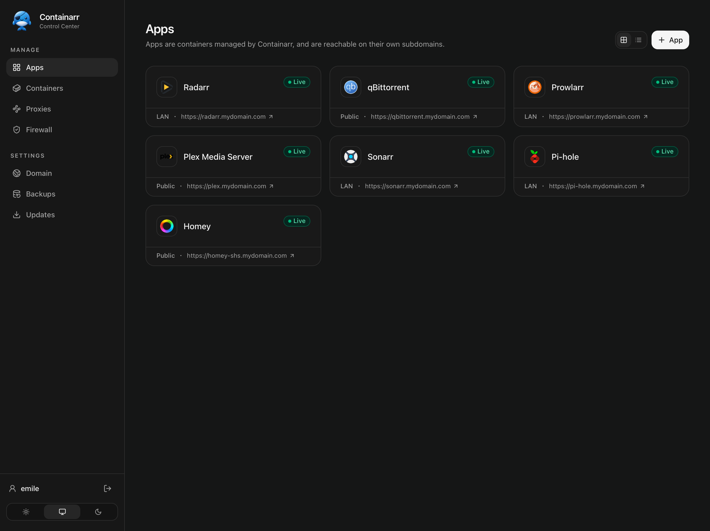

<p align="center">
<a href="#getting-started"></a>
</p>
<h3 align="center">Containarr</h3>
<p align="center">The easiest way to self-host Docker containers on your homelab server!</p>

---

👋 **Welcome to Containarr!** Containarr includes everything you need to:

* Install, run & update Docker containers.
* Access your services securely — for example `https://plex.mydomain.com` and `https://sonarr.mydomain.com`.
* Keep your domain connected with built-in Dynamic DNS. Simply point `*.mydomain.com` to `mydomain.containarr.me` with a CNAME record. HTTPS automatically works!
* Control who can access each service. Make services public or restrict them to specific IP addresses and networks.
* Automatically update containers or receive a notification when an update becomes available.
* Manage everything through a beautiful web interface designed for both desktop and mobile.

> A friendly warning: Containarr is intentionally opinionated, so it may not be for everyone, and that’s perfectly fine. There are plenty of excellent alternatives available.

# Screenshots




[View more screenshots »](https://github.com/Containarr/containarr/tree/main/screenshots)

# Requirements

* A Linux host, e.g. Raspberry Pi
* Port 80 (HTTP) and 443 (HTTPS) available in your router.

# Getting Started

Open a terminal or SSH session on your host device.

## 1. Install Docker

If you haven't installed Docker yet, install it by running:

```bash
$ curl -sSL https://get.docker.com | sh
$ sudo usermod -aG docker $(whoami)
$ exit
```

And log in again.

## 2. Run Containarr

```bash
$ docker run \
  --detach \
  --name=containarr \
  --network=host \
  --volume ~/.containarr/:/data/ \
  --volume /var/run/docker.sock:/var/run/docker.sock \
  --restart unless-stopped \
  ghcr.io/containarr/containarr:latest
```

> 💡 Your settings will be saved in `~/.containarr`.

<details>

  <summary>Alternative: docker-compose.yml</summary>

  ```yaml
  services:
    containarr:
      image: ghcr.io/containarr/containarr:latest
      container_name: containarr
      restart: unless-stopped
      volumes:
        - ~/.containarr:/data
        - /var/run/docker.sock:/var/run/docker.sock
      network_mode: host
  ```
</details>

## 3. Open a Browser

Open [http://localhost](http://localhost) in your web browser to set-up Containarr, and run your first container. Or, navigate to `http://<ip-of-your-host>` if you're running Containarr on another device.

## Backups

Choose **Git**, **S3**, or **SFTP** on the Backups page. Existing configurations continue using Git. Containarr backs up its database and selected app volumes every 6 hours by default. Change **Interval** to adjust the schedule; `0` disables the schedule. Saving backup settings starts a new interval without running a backup. Configuration changes do not trigger backups; use **Back Up Now** to run one manually. The schedule is saved across restarts, and an overdue backup runs on startup.

For **Git**, connect an empty private repository with Git LFS support and add the displayed deploy key with write access. Git keeps previous backup commits; GitHub LFS retains old objects even after history is rewritten.

For **S3**, enter your provider's endpoint URL, private bucket, optional path prefix, access key ID, and secret access key. Region is optional: Containarr detects it for standard AWS, Backblaze B2, and Cloudflare R2 endpoints and otherwise uses `us-east-1`. Enter an override if your provider requires a different signing region. Use HTTPS for remote storage. The credentials need permission to upload objects (including multipart uploads and aborts), list the bucket's backup prefix, and delete expired backups. A blank secret field preserves the saved secret, which is never returned to the browser. If bucket versioning retains deleted objects, configure provider lifecycle rules to expire those versions and incomplete multipart uploads; deleting an object alone may not reclaim storage.

For **SFTP**, enter the server host, port, username, and absolute backup directory. Add the displayed SSH public key to that user's `authorized_keys`; Containarr uses its generated private key to authenticate and remembers the server host key after the first authenticated connection. Later connections reject a changed key. Previously configured fingerprints remain enforced. After a legitimate server key rotation, verify the new key with your server administrator before clearing the matching entry in `/data/backups/sftp_known_hosts` (and any legacy fingerprint in the saved SFTP configuration). The account must be able to create the directory and upload, list, rename, and delete files there.

S3 and SFTP store complete `.tar` snapshots containing `db.sqlite`, `volumes/manifest.json`, and the compressed volume archives. **Keep Backups** defaults to 7; set it to 1 for only the latest snapshot. Each successful upload is followed by deletion of older completed snapshots from this installation at the selected destination. Other files and other installations' backups are left alone. Failed uploads do not prune previous backups. Switching destinations leaves backups at the old destination intact. These are full snapshots, so allow storage for the retained snapshots plus a new upload. They are not encrypted by Containarr; restrict access to the destination, as the database and app data can contain credentials. To restore, download and extract a snapshot, then follow the database and volume restoration steps below. Preserve Containarr's backup SSH key separately if you want to reuse its SFTP authorization after reinstalling.

When adding or editing an app, select **Include in Backup** for each volume containing user data. All volumes start excluded, so large media libraries remain out of backups unless selected. Both host paths and named Docker volumes are supported. The Backups page lists selected volumes in a sortable table with links to their apps, shows their current size, flags volumes larger than 100 MB, and lets you exclude them from future backups.

Backups contain `db.sqlite` and compressed archives in `volumes/`. `volumes/manifest.json` maps each archive to its app and original volume mapping. With the Git strategy, Containarr stores `volumes/*.tar.gz` with Git LFS while keeping the database and manifest in normal Git, so the private repository must support Git LFS. Install Git LFS before cloning a backup repository for restoration. Existing regular archive commits are not rewritten; future backups migrate the latest archives to LFS. To restore app data, stop the app, extract the matching archive into a temporary directory, and restore the contents of `backup-source` to the original host path or named volume, preserving ownership and permissions. Restore `db.sqlite` to Containarr’s data directory while Containarr is stopped.

Volume files are copied while apps are running. Stop apps that need a consistent database snapshot before taking a manual backup. Deselecting a volume removes its archive from the next snapshot. Earlier copies remain in Git or LFS history, or in retained S3/SFTP snapshots. Your storage provider’s limits still apply.

## Changelog URL

The Updates page always shows [CHANGELOG.md](https://github.com/Containarr/containarr/blob/main/CHANGELOG.md) below the update card. Set the `CONTAINARR_CHANGELOG_URL` environment variable to override the public Markdown URL. It defaults to `https://raw.githubusercontent.com/Containarr/containarr/main/CHANGELOG.md`.

# Roadmap

- Protect services with `Sign in with Google`.
- Create a native iOS app. _Maybe Android?_
- Create a Command-Line Interface `@containarr/cli`.
- Expand the [Apps Registry](https://github.com/Containarr/registry.containarr.com).

# Architecture

Containarr embeds Traefik, a reverse proxy webserver, that listens on port 80 (HTTP) and port 443 (HTTPS).

```
Internet → Router → Host → Traefik inside Containarr → App
```

For example:

```
https://plex.mydomain.com → Router → 192.168.1.100:443 → Traefik → http://172.17.0.2:32400
```

> Containarr's own web UI listens on `127.0.0.1:81`, and Traefik proxies it on ports 80 and 443.

# FAQ

**I forgot my admin password. How can I reset it?**

Run this command on the Docker host while Containarr is running:

```bash
docker exec containarr node /app/reset-password.mjs
```

Replace `containarr` if your container has a different name. The command prints your admin username and a newly generated password, and signs out existing sessions. Sign in with these credentials, click your username in the sidebar, and choose **Change Password**. Your apps and settings are preserved, and no restart is needed.

**My host already listens on port `80` and/or `443`, can I still use Containarr?**

If you cannot disable the service that runs on those ports, for example on Synology NAS, you can customize the HTTP and HTTPS ports that Containarr listens on.

Set the environment variables of Containarr to 

|Environment Variable|Default Value|New Value|
|---|---|---|
|`PORT_HTTP`|`80`|`8000`|
|`PORT_HTTPS`|`443`|`4430`|

Then in your router, set-up port forwarding so that the external port `80` is forwarded to your host's port `8000`, and the external port `443` is forwarded to `4430`. This entirely bypasses the service that's already listening on ports `80` and/or `443`.

<details>

  <summary>Terminal</summary>

	$ docker run \
	  --detach \
	  --name=containarr \
	  --network=host \
	  --volume ~/.containarr/:/data/ \
	  --volume /var/run/docker.sock:/var/run/docker.sock \
	  --restart unless-stopped \
	  --env PORT_HTTP=8000 \
	  --env PORT_HTTPS=4300 \
	  ghcr.io/containarr/containarr:latest
</details>

<details>

  <summary>docker-compose.yml</summary>

  ```yaml
  services:
    containarr:
      # ...
      environment:
        - PORT_HTTP: 8000
        - PORT_HTTPS: 4430
  ```
</details>

# Contributing

## Sponsoring

The easiest way to help is to [buy the author a beer](https://github.com/sponsors/WeeJeWel)! 🍻

## Development

At this time, please report any issues, or create small pull requests for bugs you've found.

For new features, please discuss first before opening a pull request to avoid disappointment.
